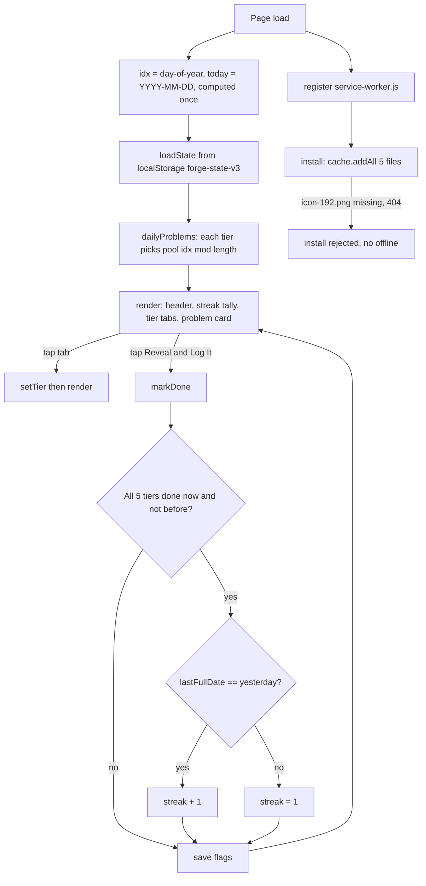

# Everyday ("Daily Forge") — Interview Deep-Dive

> **Repository:** `everyday` · 4 commits on 2026-07-14 by Siddhartha Raja (an upload, a rename `index_1.html → index.html`, and edits to `service-worker.js` and `index.html`).
> **Files:** `index.html` (503 lines; the problem bank, logic and UI), `service-worker.js` (39 lines), `manifest.json`, `ico192.png`. There's no README or test.
> **How I verified things:** I read every file and counted the problem bank in Node. I checked several answers numerically (the Collatz 27 path, the Rule of 72, the birthday paradox). I ran the app in headless Chromium to test service-worker installation, offline reload and streak behaviour. I then re-ran the offline test on a copy where the icon files had the names the code expects, to confirm the cause. **(verified)** marks things I ran.

---

## TL;DR (read this first)

- **What it is:** a tiny installable web app that gives you **one thinking problem per difficulty tier per day**. There are five tiers (Easy, Medium, Hard, Impossible, Abyss) across subjects like math, physics, logic, ethics and economics. You think, tap **Reveal & Log It**, read the answer and the "why", and build a **streak** by finishing all five tiers each day.
- **How it works:** 72 hand-written problems are hard-coded in the page. Today's problem in each tier is `pool[dayOfYear % poolSize]`. Progress and the streak are saved in `localStorage`. A service worker is supposed to make it work offline.
- **Three biggest weaknesses:**
  1. **Offline mode is broken.** The page, manifest and service worker all expect `icon-192.png` and `icon-512.png`, but the repo only has `ico192.png`. `cache.addAll` fails if *any* file is missing, so the service worker never installs: the cache is empty and an offline reload fails (verified). With correctly named icons, it installs and caches everything (verified). The footer's "Works offline" is currently untrue.
  2. **The streak display goes stale.** The streak only changes when you complete a day, so after missing days the old number stays on screen. A stored streak of 10 from 2020 still shows "10" (verified). It only drops to 1 when you next complete all five.
  3. **Date handling is fragile.** "Today" is computed once at page load (`index.html:368-369`), so leaving the app open past midnight logs progress to the previous day. "Yesterday" is `now − 24 h` (`:388`), which can be wrong around daylight-saving changes. The function named `dayIndexUTC` actually uses *local* date parts (`:344-349`).

---

## 1. The pitch (30 seconds)

"Daily Forge is a 'one cognitive rep a day' app. Every day it serves five problems of increasing difficulty: Easy and Medium are puzzles with real answers, Hard is a stretch, and Impossible and Abyss are genuinely open questions like P vs NP or the measurement problem, where the 'answer' is a framework rather than a solution. I wrote 72 problems across 13 subjects, each with hints, an answer and an explanation. The app is a single HTML file, installs to your home screen, keeps a streak in local storage, and needs no account."

**Honest framing:** it's a small personal app. Most of the value is the curated content. There's no answer checking: you self-report by revealing.

---

## 2. Explained like you've never coded

- **One page, no server.** All 72 questions live inside `index.html` as a JavaScript list. Nothing is downloaded after the first visit apart from fonts.
- **Picking today's question.** Number the days of the year 1–365. For a tier with 17 questions, today's question is "day number divided by 17, take the remainder". Everyone sees the same question on the same date, and it cycles every 17 days.
- **Saving progress.** The browser's `localStorage` remembers which tiers you've revealed today and your streak. If you clear browser data, it's gone.
- **Offline.** A *service worker* is a helper script that saves copies of the app's files so it can open without internet. Here it fails because of a misnamed icon file.

---

## 3. Architecture



### State shape (`index.html:362`)

```json
{ "streak": 3, "longest": 7, "lastFullDate": "2026-07-14",
  "history": { "2026-07-14": { "Easy": true, "Medium": true, "Hard": false, "Impossible": false, "Abyss": false } } }
```

---

## 4. Tech stack and alternatives

| Piece | Used | Alternatives |
|---|---|---|
| UI | Vanilla JS; `render()` rebuilds the whole card as one template string (`:411-491`) | Preact/Lit for diffing; `<template>` cloning |
| Escaping | `esc()` via `div.textContent → innerHTML` (`:405-409`) for all problem text | DOM building with `textContent` |
| Content | JS arrays in the page (`:39-325`) | A JSON file per tier, loaded and cached; a CMS |
| Storage | `localStorage` key `forge-state-v3` (`:355`) | IndexedDB; optional cloud sync |
| Offline | Cache-first for same-origin, network-first for others (`service-worker.js:27-39`) | Workbox precache + runtime caching for fonts |
| Fonts | Google Fonts: Oswald, Source Serif 4, JetBrains Mono (`:13`) | Self-host for real offline use |

---

## 5. Code walkthrough (file:line)

| Where | What |
|---|---|
| `index.html:7-9` | Manifest link; favicon and apple-touch-icon point to **`icon-192.png` (doesn't exist)** |
| `index.html:13` | Google Fonts stylesheet |
| `index.html:14-30` | CSS: dark palette, `forgeIn` card animation, tally marks |
| `index.html:36-38` | Comment: "72 problems across 5 tiers. No code problems." (the count is right: 17+18+14+13+10 = 72, verified) |
| `index.html:39-101` | `EASY` (17); each item is `{cat, prompt, notes[], answer, explain}` |
| `index.html:103-169` | `MEDIUM` (18) |
| `index.html:171-227` | `HARD` (14) |
| `index.html:229-282` | `IMPOSSIBLE` (13) |
| `index.html:284-325` | `ABYSS` (10) |
| `index.html:327-339` | `TIERS` (data + colour), `TIER_ORDER`, `CATEGORY_SYMBOL` for 13 categories |
| `index.html:344-349` | `dayIndexUTC()`: `Date.UTC(localYear, localMonth, localDate) − Date.UTC(localYear, 0, 0)` ÷ 86,400,000 = **local** day-of-year (1–366) |
| `index.html:350-353` | `dateKey()`: local `YYYY-MM-DD` |
| `index.html:357-366` | `loadState`/`saveState`, both wrapped in try/catch; errors swallowed silently |
| `index.html:368-372` | `idx`, `today`, `state` and `revealedMap` computed **once** |
| `index.html:374-378` | `dailyProblems[t] = pool[idx % pool.length]` |
| `index.html:380-398` | `markDone`: set the flag; if this reveal completes all five tiers, compare `lastFullDate` with yesterday (`Date.now() − 86400000`), then increment or reset the streak and update `longest` |
| `index.html:411-491` | `render`: tally (capped at 20 marks + "+N more"), tabs with done-dots, card, notes, answer ("Framework" for Impossible/Abyss), button, footer "… · Works offline" |
| `index.html:496-500` | Service-worker registration; errors swallowed by `.catch(() => {})` |
| `manifest.json` | Name "Daily Forge"; description says "Easy, Medium, Hard, Impossible" (**4 tiers, omits Abyss**); icons `icon-192.png` and `icon-512.png` (**both missing**) |
| `service-worker.js:1-8` | `daily-forge-v2`; ASSETS include both missing icons |
| `service-worker.js:10-15` | `install`: `cache.addAll(ASSETS)` inside `waitUntil` (atomic: one 404 rejects the whole install) |
| `service-worker.js:17-24` | `activate`: delete old caches; `clients.claim()` |
| `service-worker.js:26-39` | Same-origin: cache, falling back to network. Cross-origin: network, falling back to cache, but **nothing ever puts fonts in the cache**, so that fallback never hits |

---

## 6. Theory you should be able to explain

**6.1 Deterministic daily rotation.**
- $i_t = d \bmod n_t$, where $d$ is the day of the year and $n_t$ the pool size of tier $t$.
- The tiers have co-prime-ish sizes (17, 18, 14, 13, 10), so the *combination* of five problems repeats only after $\operatorname{lcm}(17,18,14,13,10)=139{,}230$ days. Each tier on its own repeats every $n_t$ days.
- Because $d$ restarts every 1 January, the sequence also "jumps" at New Year. Using days since a fixed epoch would avoid that.

**6.2 Streak logic as a tiny state machine.** The state is `(streak, lastFullDate)`. When a day becomes fully complete:
- if `lastFullDate == yesterday`, then `streak += 1`;
- otherwise `streak = 1`.

The *displayed* value should be computed: if `lastFullDate` is neither today nor yesterday, the current streak is 0.

**6.3 Service-worker install semantics.** `Cache.addAll` is atomic: if any request fails, nothing is cached and the promise rejects. Inside `event.waitUntil`, that rejection makes the install fail, so the worker is thrown away. That's why one misnamed icon disables offline mode entirely.

**6.4 Dates and time zones.** A "day" for a habit app should be the user's local calendar day.
- Subtracting 24 h from "now" isn't "yesterday" on days with 23 or 25 hours (DST).
- The safer way is calendar arithmetic: `new Date(y, m, d − 1)`.
- Computing `today` once means a long-lived tab or PWA keeps the old date. It should be recomputed on each action or on `visibilitychange`.

**6.5 Content correctness spot-checks (verified numerically).**
- Collatz from 27: 111 steps, peak 9,232 (the text says "above 9,000" ✓).
- Rule of 72 at 10%: exact $\ln 2/\ln 1.1 = 7.27$ ✓.
- Birthday paradox, 23 people: 50.73% ✓.
- Inelastic collision: $(2·3)/6 = 1$ m/s ✓.
- Square inscribed in a radius-5 circle: area $10^2/2 = 50$ ✓.
- 8-ball weighing: 3-3-2 split ✓.

---

## 7. Data, privacy and leakage

- Data is all local; there are no accounts and no analytics. Google Fonts requests do reveal the visitor's IP to Google.
- **"Answer leakage" by design:** the hints (`notes`) are shown *before* reveal and sometimes give the answer away. For example, the Easy "Systems" hint names a "feedback loop", and the Medium "Physics" hint names the Doppler effect.
- There's no ML or dataset, so no train/test leakage.

---

## 8. Evaluation and results

There are no metrics, tests or usage data in the repo. What I checked:

| Check | Result | Source |
|---|---|---|
| Problem count claim "72 across 5 tiers" | 17 + 18 + 14 + 13 + 10 = 72 ✓ | Node (verified) |
| Missing assets | `GET /icon-192.png → 404` | Chromium (verified) |
| SW registration after load | **none**; cache `daily-forge-v2` empty | verified |
| Offline reload | **fails** (`ERR_INTERNET_DISCONNECTED`) | verified |
| Same app with icons renamed correctly | SW active; all 5 assets cached | verified |
| Stale streak | Stored streak 10, last full 2020-01-01 → shows **10** | verified |
| Completing all 5 tiers after that gap | streak → 1 ✓ | verified |
| Numeric answers spot-checked | all correct (§6.5) | verified |

---

## 9. Design trade-offs

| Decision | Upside | Downside |
|---|---|---|
| Content hard-coded in HTML | One file, instant load | Editing content means editing code; no localisation |
| Same problem for everyone each day | Shareable ("did you get today's?"), deterministic | Repeats every n days; resets at New Year |
| Self-reported "Reveal & Log It" | No answer parsing needed; open-ended tiers work | The streak measures *reveals*, not thinking or correctness |
| Re-render everything via `innerHTML` | Simple | Event listeners re-attached each render; animation replays on every tab switch |
| Streak requires all 5 tiers | Encourages the full workout | Harsh: a day with 4/5 counts as zero |

---

## 10. Honest weaknesses

1. **Offline is broken** by the icon filename mismatch (`index.html:8-9`, `manifest.json`, `service-worker.js:6-7` vs. `ico192.png`), and the error is swallowed (`index.html:498`).
2. **The streak shows a stale value** after missed days (`:461`).
3. **Midnight rollover and DST bugs** (`:368-369`, `:388`). `dayIndexUTC` is misnamed.
4. **Small pools:** Abyss repeats every 10 days and Easy every 17.
5. **No self-assessment:** you can farm the streak by tapping reveal five times.
6. **The manifest description omits the Abyss tier**; there's no `icon-512.png` at all.
7. **Fonts aren't cached**, so even with a working SW, offline text falls back to Georgia/monospace.
8. **Hints sometimes give the answer away.**
9. **No README, licence or tests.**
10. A few content claims are stated as fact without a source (e.g. the Netflix "Most Popular" tier framing).

---

## 11. Prioritised improvements

| # | Change | Effort | Impact |
|---|---|---|---|
| 1 | Add `icon-192.png` and `icon-512.png` (or fix all references to `ico192.png`); bump `CACHE_NAME` | 5 min | High (offline works) |
| 2 | Compute the displayed streak from `lastFullDate` (0 if older than yesterday) | 15 min | High |
| 3 | Recompute `today`/`idx` on each action and on `visibilitychange`; use calendar arithmetic for yesterday | 30 min | Medium |
| 4 | Use days since a fixed epoch instead of day-of-year | 5 min | Low |
| 5 | Cache Google Fonts at runtime or self-host them | 30 min | Low-Medium |
| 6 | Add a "Got it / Missed it" self-grade after reveal; keep accuracy stats per category | 2 h | Medium |
| 7 | Move content to JSON; grow the pools; add a source/reference field per problem | ongoing | Medium |
| 8 | Show the streak card when you return after missing days ("streak lost") | 30 min | Low |
| 9 | Playwright test: SW installs, offline reload, streak transitions with a mocked clock | 2 h | Medium |

---

## 12. How to run

1. Serve the folder over HTTP (service workers need `http://localhost` or HTTPS): `python3 -m http.server 8000`, then open `http://localhost:8000/`.
2. For offline support/installation, first add icons named `icon-192.png` and `icon-512.png` (see §10).
3. There are no environment variables or build step.

---

## 13. Resume bullets (truthful)

- Built "Daily Forge", an installable vanilla-JS PWA that serves one problem per day in five difficulty tiers from a hand-curated bank of 72 problems across 13 subjects, with hints, answers and explanations.
- Implemented deterministic daily rotation and an all-tiers streak tracker persisted in `localStorage`, with no account or backend.
- Designed the open-ended "Impossible/Abyss" tiers around unsolved problems (P vs NP, the measurement problem, Parfit's Repugnant Conclusion), presenting a reasoning framework rather than an answer.

*(Don't claim "works offline" until the icon fix is in, and don't claim user numbers.)*

---

## Glossary

- **PWA:** a web page that can be installed and (ideally) work offline.
- **Service worker:** a background script that can serve cached files.
- **`cache.addAll`:** saves a list of files; fails completely if any one is missing.
- **404:** "file not found" from a web server.
- **localStorage:** a small per-site storage box in the browser.
- **Modulo (`%`):** the remainder after division; used to cycle through a list.
- **Streak:** the number of consecutive days a goal was met.
- **DST:** daylight-saving time; some days have 23 or 25 hours.
- **LCM:** least common multiple; when several cycles line up again.
- **Fermi problem:** estimating an unknown number from a chain of rough assumptions.
